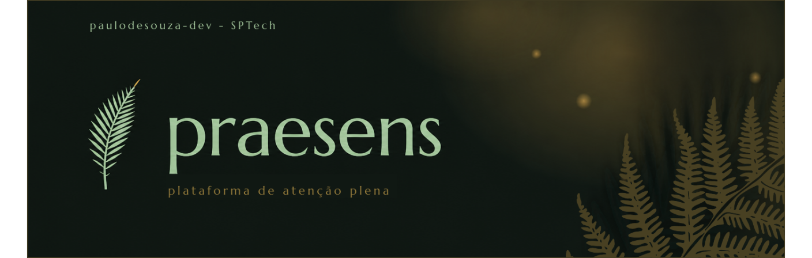
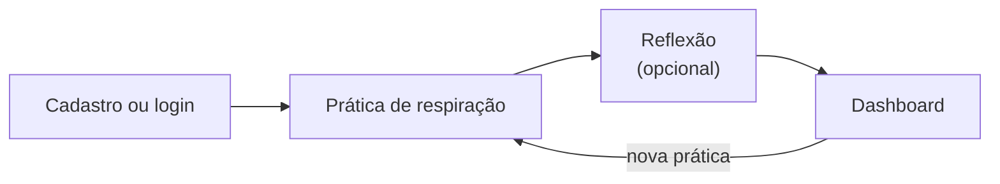
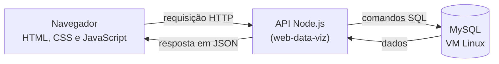
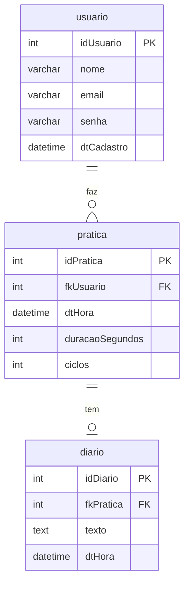

<div align="center">



<br>


[](#sobre)
[](#funcionalidades)
[](#arquitetura)
[](#identidade-visual)
[](#tecnologias)
[](#como-rodar)
[](#autor)

</div>

---

## Sobre

A Praesens é uma plataforma web de atenção plena (mindfulness), respiração guiada e reflexão pessoal. O nome vem do latim praesens, "aqui e agora". O projeto foi desenvolvido como Projeto Individual da Sprint 3 na SPTech.

O tema tem significado pessoal para mim, práticas de respiração e atenção ao presente me ajudam a cultivar paz e alegria. Com esse projeto, quero compartilhar o que sinto sobre esse tema com outras pessoas.

A pessoa pratica, escreve se quiser sobre a prática, e acompanha a própria jornada.

---

## Objetivos

<div align="left">
🌿 Criar um espaço digital para fazer práticas de respiração e atenção plena. <br> <br>
🌿 Guiar práticas de respiração com instruções visuais, ritmo e temporização. <br> <br>
🌿 Oferecer um espaço livre de escrita para pensamentos e reflexões, sem perguntas predefinidas. <br> <br>
🌿 Registrar a jornada de cada pessoa e exibi-la em um dashboard com indicadores. <br> <br>
🌿 Aplicar na prática os conteúdos do primeiro semestre na SPTech.
</div>

---

## Funcionalidades

| Tela | O que tem | Status |
|---|---|:-:|
| **Home** | Apresenta a proposta do Praesens e explica o suspiro fisiológico em cards com imagem e texto | Pronto |
| **Cadastro e login** | Criação de conta e acesso, com validação em JavaScript e requisitos da senha mostrados em tempo real | Pronto |
| **Respiração guiada** | Prática do suspiro fisiológico com contador de cada fase, ciclos e tempo total | Pronto |
| **Reflexão** | Espaço livre e opcional para escrever depois de cada prática | Pronto |
| **Dashboard** | Indicadores com comparação semanal, gráfico dos últimos 7 dias e histórico com as reflexões | Pronto |

### Fluxo do usuário



---

## Respiração guiada

A prática usa o **suspiro fisiológico**: duas inspirações seguidas e uma expiração longa. A tela mostra o nome de cada fase e os segundos que faltam.

| Fase | Tempo |
|---|:-:|
| Inspire | 5s |
| Segure | 2s |
| Inspire mais um pouco | 2s |
| Segure | 2s |
| Solte devagar | 9s |

Cada ciclo dura **20 segundos**, ou 3 respirações por minuto. Ao terminar, a duração e os ciclos são gravados no banco de dados.

Um ensaio clínico com 108 participantes mostrou que 5 minutos por dia de suspiro cíclico, durante um mês, melhoraram o humor e reduziram a ansiedade (Balban et al., 2023).

---

## Dashboard

<div align="left">
🌿 <b>Quantidade de práticas</b>, com a diferença em relação à semana passada. <br> <br>
🌿 <b>Tempo total</b> em minutos, com a diferença em relação à semana passada. <br> <br>
🌿 <b>Gráfico de barras</b> (Chart.js) com os minutos praticados em cada um dos últimos 7 dias, com o dia de hoje em destaque. <br> <br>
🌿 <b>Histórico</b> das 5 últimas práticas, com data, duração, ciclos e a reflexão escrita. <br>
</div>

---

## Arquitetura



A API roda no computador e se conecta ao banco MySQL, que fica sozinho em uma VM Linux.

### Rotas da API

| Método | Rota | O que faz |
|:-:|---|---|
| POST | `/usuarios/cadastrar` | Cria uma conta |
| POST | `/usuarios/autenticar` | Faz o login |
| POST | `/praticas/registrar` | Grava uma prática concluída |
| GET | `/praticas/resumo/:idUsuario` | Quantidade de práticas e tempo total |
| GET | `/praticas/periodo/:idUsuario/:inicio/:fim` | Práticas e minutos de um período (usado na comparação semanal) |
| GET | `/praticas/semana/:idUsuario` | Minutos por dia nos últimos 7 dias |
| GET | `/praticas/historico/:idUsuario` | As 5 últimas práticas com a reflexão |
| POST | `/diarios/registrar` | Grava a reflexão de uma prática |

### Banco de dados



Um usuário faz várias práticas (1:N). Cada prática pode ter no máximo uma reflexão (1:1), e o `UNIQUE` em `fkPratica` garante isso.

---

## Identidade visual

A samambaia é uma planta que gosto muito, e não só pela estética. Essa é uma das plantas mais antigas do planeta e já ajudava a formar as grandes florestas do período Carbonífero, entre cerca de 359 e 299 milhões de anos atrás. Ou seja, ela já estava por aqui muito antes da nossa espécie sequer esboçar existir. Por esse e outros motivos, essa é a minha planta favorita, então decidi que precisava implementar nesse projeto de alguma forma!!

<div align="center">


</div>

O fundo do site é uma representação artística de uma floresta do Carbonífero, escurecida e tingida com as cores do projeto.

| Cor | Código | Papel |
|---|---|---|
| Noite da Floresta | `#0E1612` | Fundo e sombras |
| Sálvia | `#A9CBA3` | Textos, samambaia e gráficos |
| Luz | `#DDAA4F` | Botões e destaques |

**Fontes:** Marcellus nos títulos e no nome, Nunito Sans nos textos.

---

## Tecnologias

| Camada | Tecnologia | Uso |
|---|---|---|
| Estrutura | HTML5 | Todas as telas |
| Estilo | CSS3 | Identidade visual e responsividade, com um arquivo comum e um por página |
| Lógica | JavaScript | Validações, respiração guiada e montagem do dashboard |
| Gráficos | Chart.js | Gráfico de barras do dashboard |
| API | Node.js (web-data-viz) | Cadastro, login, práticas, diário e indicadores |
| Banco de dados | MySQL, em uma VM Linux (Lubuntu no VirtualBox) | Usuários, práticas e diário |
| Versionamento | Git e GitHub | Evolução do código |
| Planejamento | Trello | Organização das entregas |

---

## Como rodar

**Pré-requisitos:** Node.js e um servidor MySQL (no meu caso, em uma VM Linux).

```bash
# 1. Clone o repositório
git clone https://github.com/paulodesouza-dev/praesens.git

# 2. Entre na pasta da aplicação
cd praesens/projeto-praesens

# 3. Instale as dependências
npm i
```

4. No MySQL, rode o script `src/database/script-tabelas.sql` para criar o banco e as tabelas.
5. Crie um arquivo `.env` na pasta `projeto-praesens` com os dados de conexão:

```
AMBIENTE_PROCESSO=producao
DB_HOST=
DB_DATABASE=praesens
DB_USER=
DB_PASSWORD=
DB_PORT=
APP_PORT=
APP_HOST=localhost
```

6. Inicie a aplicação e abra no navegador o endereço que aparecer no terminal:

```bash
npm start
```

> O arquivo `src/database/dados-teste.sql` insere práticas em datas passadas. Ele serve só para testar e demonstrar a comparação entre semanas no dashboard.

---

## Uso de IA

Assistentes de IA foram usados no projeto, conforme as regras da disciplina. O registro do que foi pedido, usado e alterado está no [Diário de Prompts](projeto-praesens/public/docs/diario-de-prompts/diario-de-prompts.md).

---

## Autor

<div align="center">

<a href="https://github.com/paulodesouza-dev">
  
</a>

### Paulo Henrique de Souza

Estudante da **São Paulo Tech School**

[](https://github.com/paulodesouza-dev)

</div>

---

## Observação

Este projeto foi desenvolvido para fins acadêmicos, com o objetivo de aplicar os conhecimentos adquiridos durante o curso. Além do desenvolvimento técnico, o Praesens representa a minha relação pessoal com a respiração e práticas de atenção plena.

<br>

---
<div align="center">

### English summary </div>

*<div align="center"> A short overview for international readers. The full documentation is in Portuguese above. </div>*

### Context

Praesens is a web platform for mindfulness, guided breathing and personal reflection. The name comes from the Latin *praesens*, meaning "present", and reflects the idea of being here and now. It is an individual project developed during my first semester at São Paulo Tech School (SPTech).

**Why this project?** Breathing practices and present moment awareness help me cultivate peace and joy, and I want to share that experience with other people through a simple, calm and welcoming digital space.

**Why a fern?** The fern is one of the oldest plants on Earth. It already helped form the great forests of the Carboniferous period, roughly 359 to 299 million years ago, long before our species existed. I personally find this amazing, it is my favorite plant, so it became the symbol of the project.

### Features

**Guided breathing:** the physiological sigh (inhale 5s, hold 2s, inhale again 2s, hold 2s, slow exhale 9s), with a countdown for each phase. <br>
**Reflection journal:** an optional free writing space after each practice. <br>
**Dashboard:** number of practices and total minutes compared with the previous week, a 7-day bar chart (Chart.js) and the last 5 practices with their reflections. <br>
**Sign up and login:** user accounts with form validation in JavaScript and live password requirements. <br>

### Tech stack

HTML, CSS and JavaScript on the front end, a Node.js API, and a MySQL database running on a Linux virtual machine. Charts with Chart.js. Version control with Git and GitHub, and planning with Trello.

### Status

Completed. The final presentation takes place between November 26 and December 4, 2026.
