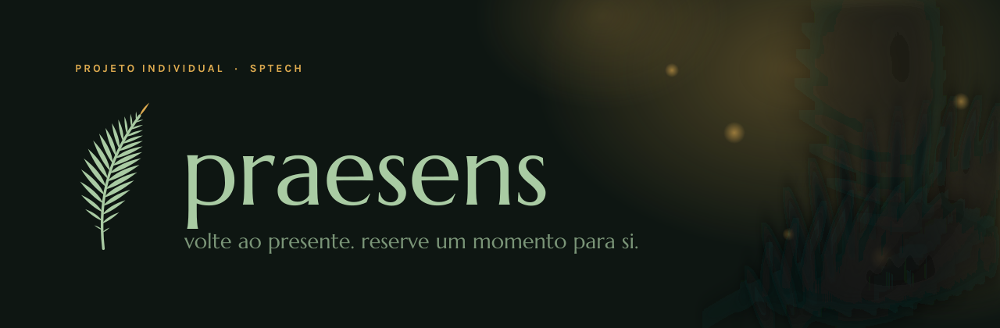
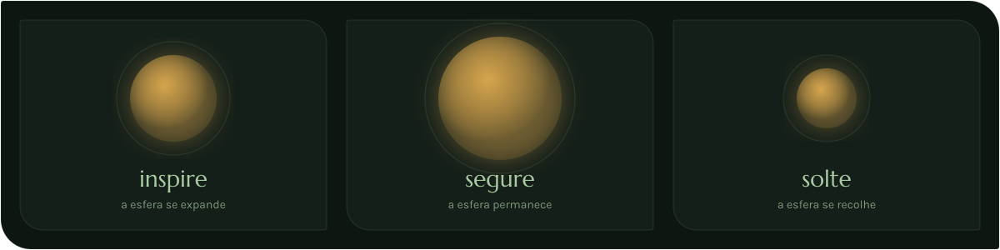
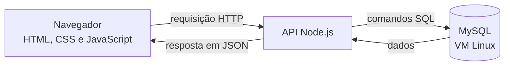

<div align="center">



<br>


**[Sobre](#sobre)** · **[Funcionalidades](#funcionalidades)** · **[Arquitetura](#arquitetura)** · **[Tecnologias](#tecnologias)** · **[Como rodar](#como-rodar)** · **[Autor](#autor)**

</div>

---

## Sobre

A **Praesens** é uma plataforma web de atenção plena (*mindfulness*), respiração guiada e reflexão pessoal. O nome vem do latim *praesens*, "aqui e agora". O projeto foi desenvolvido como Projeto Individual da Sprint 3 na SPTech.

O tema tem significado pessoal para mim: práticas de respiração e atenção ao presente me ajudam a cultivar paz e alegria. Com o Praesens, quero transformar parte dessa experiência em um momento de pausa para outras pessoas.

---

## Objetivos

🌿 Criar um espaço digital para fazer práticas de respiração e atenção plena. <br> <br>
🌿 Guiar práticas de respiração com instruções visuais, ritmo e temporização. <br> <br>
🌿 Oferecer um espaço livre de escrita para pensamentos e reflexões, sem perguntas predefinidas. <br> <br>
🌿 Registrar a jornada de cada pessoa e exibi-la em um dashboard com indicadores. <br> <br>
🌿 Aplicar na prática os conteúdos do primeiro semestre na SPTech.

---

## Funcionalidades

| Tela | O que terá | Status |
|---|---|:-:|
| **Home** | Apresenta a proposta do Praesens e convida a pessoa a conhecer a plataforma | Planejado |
| **Cadastro e login** | Criação de conta e acesso, com validação dos formulários em JavaScript | Planejado |
| **Respiração guiada** | Prática interativa com instruções visuais, ritmo e temporização | Planejado |
| **Diário pessoal** | Espaço livre para escrever pensamentos, sentimentos e reflexões | Planejado |
| **Dashboard** | Painel visual para acompanhar a jornada, com indicadores das práticas | Planejado |

---

### Respiração guiada

A prática guia o usuário por três momentos, representados por uma esfera de luz que se expande, permanece e se recolhe. Cada prática concluída será registrada no banco de dados.



---

### Dashboard

Os indicadores previstos são: <br> <br>

🌿 Quantidade de práticas realizadas. <br> <br>
🌿 Tempo total de respiração. <br> <br>
🌿 Histórico das práticas. <br> <br>
🌿 Outras métricas a definir na etapa de Pesquisa e Inovação. <br> <br>

---

## Arquitetura

Visão prevista da comunicação entre as camadas:



---

## Identidade visual

A samambaia é uma planta que gosto muito, e não só pela estética. Essa é uma das plantas mais antigas do planeta e já ajudava a formar as grandes florestas do período Carbonífero, entre cerca de 359 e 299 milhões de anos atrás. Ela não produz flores, nem sementes, na verdade, se reproduz por esporos. É minha planta favorita, então decidi que precisava implementar nesse projeto de alguma forma!!
<div align="center">


</div>

---

## Tecnologias

| Camada | Tecnologia | Uso previsto | Status |
|---|---|---|:-:|
| Estrutura | HTML5 | Todas as telas | Planejado |
| Estilo | CSS3 | Identidade visual e responsividade | Planejado |
| Lógica | JavaScript | Validação de formulários, respiração guiada e cálculos do dashboard | Planejado |
| API | Node.js (web-data-viz) | Cadastro, login e consulta ao banco de dados | Planejado |
| Banco de dados | MySQL, em uma VM Linux | Usuários, práticas e diário | Planejado |
| Versionamento | Git e GitHub | Evolução do código | Em uso |
| Planejamento | Trello | Organização das entregas | Em uso |

---

## Como rodar

```bash
# 1. Clone o repositório
git clone https://github.com/paulodesouza-dev/praesens.git

# 2. Entre na pasta
cd praesens
```

---

## Uso de IA

Assistentes de IA são usados como **apoio ao aprendizado**, para tirar dúvidas, revisar e entender erros, conforme as regras do projeto. O registro do que foi pedido, usado e alterado está no [Diário de Prompts](docs/diario-de-prompts.md).

---

## Autor

<div align="center">

<a href="https://github.com/paulodesouza-dev">
  
</a>

### Paulo Henrique de Souza

Estudante da **SPTech — São Paulo Tech School**

[](https://github.com/paulodesouza-dev)

</div>

---

## Observação

Este projeto foi desenvolvido para fins acadêmicos, com o objetivo de aplicar os conhecimentos adquiridos durante o curso. Além do desenvolvimento técnico, o Praesens representa a minha relação pessoal com a respiração e práticas de atenção plena.

<div align="center">

</div>
